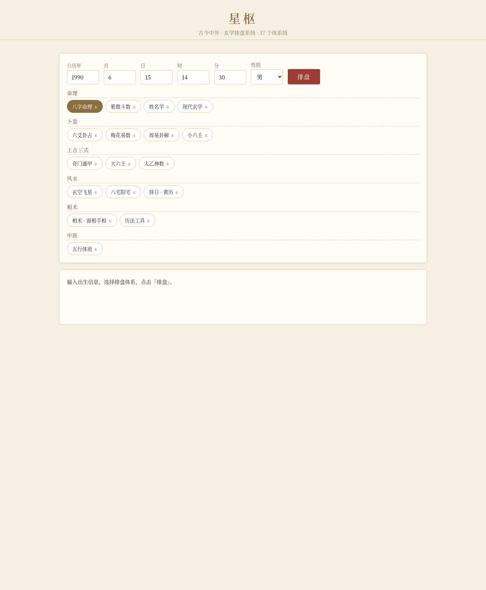

# 玄学工坊 · 纯前端术数排盘引擎

> 一个**零依赖、零构建、浏览器内直接跑**的中国术数排盘内核：15 个体系、24 个 JS 模块、5,349 行，
> 历法数据内嵌 1900–2100。打开网页就能排盘，不需要后端、不需要联网、不上传你的生日。

**核心设计：排盘由确定性引擎算，AI 只负责解读。**
模型永远不参与起局 —— 干支、节气、四柱、卦象全部来自本地可复现的算法，杜绝「模型幻觉算出错的干支」。

## 它包含什么（真实计数，脚本可复现）

| 项 | 数字 | 说明 |
|---|---|---|
| 前端内核 | **24 个模块 / 5,349 行** | 纯 ES Module，无依赖、无打包器 |
| 排盘引擎 | **15 个 / 3,058 行** | 每体系一个文件，互不耦合 |
| 历法数据 | **20 KB** | 1900–2100 公历/农历/节气/四柱，逐年 24 节气精确到分钟 |
| Python 网关 | **245 行** | 可选：把重型星象计算收敛成同一套 REST 请求模型 |
| 仓库体积 | **318 KB** | 没有 node_modules，没有构建产物 |

### 15 个引擎

`bazi` 子平八字 · `ziwei` 紫微斗数 · `liuren` 大六壬 · `qimen` 奇门遁甲 · `taiyi` 太乙神数 ·
`liuyao` 六爻纳甲 · `meihua` 梅花易数 · `yijing` 易经卦象 · `fengshui` 风水 · `huangli` 黄历择日 ·
`xiaoliuren` 小六壬 · `xiangshu` 象数 · `xingming` 星命 · `modern` 现代占星 · `tizhi` 体质



## 快速开始

**方式一：零构建，直接跑**（推荐，改完刷新就生效）

```bash
git clone <this-repo> && cd xuanxue-kernel
python3 -m http.server 8080        # 或任意静态服务器
# 打开 http://localhost:8080
```

> 必须用 HTTP 打开，不能双击 `index.html`（ES Module 受 `file://` 同源限制）。

**方式二：只当库用**

```js
import { MODULES } from './kernel/ui/modules.js';
// 或直接进引擎（每个引擎导出 paipanXxx / xxxToText 两类函数）
import { paipanBazi, baziToText } from './kernel/engines/bazi.js';

// 入参契约（与 kernel/ui/modules.js 的 F_BIRTH 一致）：y / mo / d / h / mi / gender
const r = paipanBazi({ y: 1990, mo: 6, d: 15, h: 10, mi: 0, gender: 'M' });
```

每个引擎都是纯函数：**输入出生信息对象 → 输出结构化排盘结果**，没有任何 DOM 依赖，Node 里也能跑。

**方式三：带 Python 网关**（需要重型星象计算时）

```bash
cd api && pip install fastapi uvicorn pydantic
python xuanxue_api.py 8899         # http://localhost:8899/docs 有 OpenAPI 文档
```

> ⚠️ Python 侧的 `/api/bazi` 等「本地直算」端点依赖**上游重型引擎**（见致谢），本仓不打包。
> 没装上游时它们会返回 503 并告诉你缺什么；`/health`、`/systems`、静态前端不受影响。
> 想要开箱即用，用**方式一**的前端内核（15 个体系全在前端，零依赖）。

## 架构

```
index.html          单页前端（零构建，ES Module 直接被浏览器加载）
kernel/
├── core/          历法（公历/农历/节气/四柱）、八卦六十四卦纳甲、干支五行、常数表
├── engines/       15 个排盘引擎，一体系一文件，纯函数无副作用
├── data/          calendar_data.js —— 1900–2100 历法数据（20 KB）
├── ai/            解读层：BYO-key（自带 API Key），不参与起局
└── ui/            模块注册表 + DOM 渲染 + 样式
api/xuanxue_api.py 可选 Python 网关：统一 BirthInput 请求模型，本地 11 体系 + 网关转发
```

### 为什么把「算」和「说」拆开

术数系统最容易坏在两点：一是历法口径不统一（不同流派换算出不同四柱），二是让大模型直接「算」，
于是它会理直气壮地给出一个错的干支。这个项目的分工是硬性的：

- **算**：`core/calendar.js` + `engines/*.js`，纯函数、可单测、同输入同输出。
- **说**：`ai/ai.js`，只拿排盘结果去组织语言，**API Key 由使用者自己填，默认空**。

## 已知边界（不粉饰）

- 历法以「东八区 + 节气定月」为主口径；真太阳时按经度修正，但**真太阳时+均时差的精细流派未全覆盖**。
- 前端内核覆盖 15 个体系；Python 侧还有若干重型星象/天文体系，**不在本仓**（见下方致谢）。
- 网页里的 `/systems` 接口是可选后端调用，没起后端时会静默降级为纯前端内核，功能不受影响。

## 免责声明

本项目是**中国传统文化与术数算法的工程化整理**，用于学习、研究与娱乐。
**不构成医疗、投资、法律、婚姻或任何人生决策依据。** 详见 [DISCLAIMER.md](DISCLAIMER.md)。

## 致谢与来源

本项目**只包含自己写的排盘内核与前端**。Python 侧的重型星象/术数计算能力来自开源社区，
本仓不打包、不复制这些上游代码，只提供统一请求模型的适配层：

- **kentang2017** 的 `kin*` 系列（MIT）：`kinastro`（七政四余/星命）、`kinqimen`（奇门）、
  `kintaiyi`（太乙）、`kinwuzhao`（五兆）、`kinwangji`（望气）、`kinjinkou`（金口诀）等。
  想用重型体系请直接去装上游项目，它们的 LICENSE 各自保留在本仓之外。

如果你也在这套体系里写东西，欢迎把口径差异、历法修正、新的排盘算法提交回来。

## License

MIT —— 见 [LICENSE](LICENSE)。
